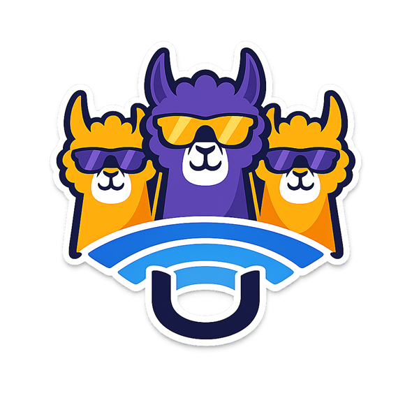
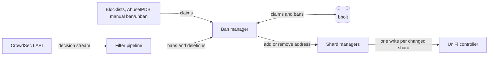

<p align="center">
  
</p>

# cs-unifi-bouncer-pro
[](https://github.com/developingchet/cs-unifi-bouncer-pro/actions/workflows/release.yml)
[](https://github.com/developingchet/cs-unifi-bouncer-pro/actions/workflows/ci.yml)
[](https://scorecard.dev/viewer/?uri=github.com/developingchet/cs-unifi-bouncer-pro)
[](https://github.com/developingchet/cs-unifi-bouncer-pro)
[](https://hub.docker.com/r/developingchet/cs-unifi-bouncer-pro)
[](LICENSE)

A [CrowdSec](https://crowdsec.net) bouncer for [UniFi](https://ui.com) network controllers.

It turns CrowdSec ban decisions into UniFi firewall objects, so malicious addresses are blocked at the gateway on every configured site.

---

## Features

- **Both firewall generations**: zone-based policies or legacy `WAN_IN`/`WANv6_IN` rules, chosen per site at startup. UniFi Network 11 applies only the zone-based firewall: legacy mode is refused there, legacy sites switch to zone mode after the controller upgrade, and policies converted from the old rules are cleaned up
- **Egress blocking**: optional `EGRESS_ZONE_PAIRS` stops hosts in zones such as a DMZ or IoT network from connecting out to banned addresses, reusing the same ban lists
- **UniFi OS and self-hosted controllers**: UniFi OS consoles, UniFi OS Server and the self-hosted UniFi Network Application (10.6 and earlier); the controller type and Network version are detected on startup
- **Multi-site**: one instance applies bans to several UniFi sites
- **Sharded ban lists**: addresses are packed into groups or traffic matching lists of up to 10,000 entries, created and merged as the ban list grows and shrinks
- **Persistent state**: bans live in an embedded bbolt database with expiry, survive restarts and are reconciled against the controller on start and periodically
- **Several ban sources**: CrowdSec decisions, plain-text blocklist URLs, [borestad/blocklist-abuseipdb](https://github.com/borestad/blocklist-abuseipdb) lists with country filters, and manual `ban`/`unban` commands; an address stays banned while any source claims it
- **Cloudflare whitelist**: optional ALLOW policies for Cloudflare's published ranges, kept ahead of the block policies
- **Filtering**: origin, scenario, scope, private-address and whitelist filters, minimum durations and per-scenario duration overrides
- **Observability**: 25 Prometheus metrics, liveness and readiness endpoints, CrowdSec usage metrics, a ban history audit trail and webhook alerts
- **Hardened image**: distroless, runs as UID 65532 with a read-only root filesystem and a seccomp profile; releases are Cosign-signed with an SBOM

---

> **Upgrading from 1.x?** 2.0 changes several defaults and rejects settings 1.x accepted. Read [docs/UPGRADING.md](docs/UPGRADING.md) before you pull the new image.

## Quick Start

**Prerequisites**: Docker Engine 20.10+, Docker Compose v2+, a running CrowdSec instance.

```bash
# 1. Register the bouncer with CrowdSec (copy the key — shown once)
docker exec crowdsec cscli bouncers add unifi-bouncer

# 2. Download compose file and seccomp profile
curl -O https://raw.githubusercontent.com/developingchet/cs-unifi-bouncer-pro/main/docker-compose.standalone.yml
curl -O https://raw.githubusercontent.com/developingchet/cs-unifi-bouncer-pro/main/security/seccomp-unifi.json

# 3. Configure (3 required values)
cat > .env <<'EOF'
UNIFI_URL=https://192.168.1.1
UNIFI_API_KEY=your-api-key-here        # Settings → Control Plane → Integrations
CROWDSEC_LAPI_KEY=paste-key-here       # from step 1
# The LAPI defaults to https://crowdsec:8080. For another URL, set CROWDSEC_LAPI_URL
# and uncomment its line in the compose file; http:// also needs CROWDSEC_LAPI_ALLOW_HTTP=true.
EOF

# 4. Check the image signature (recommended; needs cosign)
cosign verify developingchet/cs-unifi-bouncer-pro:latest \
  --certificate-identity-regexp="https://github.com/developingchet/cs-unifi-bouncer-pro/.github/workflows/release.yml@refs/tags/.*" \
  --certificate-oidc-issuer="https://token.actions.githubusercontent.com"

# 5. Start
docker compose -f docker-compose.standalone.yml up -d

# 6. Verify
docker logs -f cs-unifi-bouncer-pro
```

The compose file runs `latest`. To run a specific release instead, set
`BOUNCER_IMAGE` in `.env`, for example to `developingchet/cs-unifi-bouncer-pro:2.3.0`
or to an `@sha256:` digest that `cosign verify` reported.

For the full setup guide including advanced configuration, multi-site deployments,
TLS setup, and Docker Secrets support, see [docs/SETUP.md](docs/SETUP.md).

---

## How It Works



Every ban source records a claim on an address in the ban database; the address is added to a shard when the first claim arrives and removed when the last one goes. Changed shards are written to the controller after each decision batch and retried every `SYNC_INTERVAL`, behind a circuit breaker. [docs/DESIGN.md](docs/DESIGN.md) describes each stage, the firewall objects per mode and the startup sequence.

---

## Configuration

All configuration is via environment variables. The most common settings are below; [docs/CONFIGURATION.md](docs/CONFIGURATION.md) lists every setting with its validation rules.

`UNIFI_API_KEY`, `UNIFI_USERNAME`, `UNIFI_PASSWORD` and `CROWDSEC_LAPI_KEY` also accept a `_FILE` variant pointing to a file containing the value, for Docker and Kubernetes secrets.

| Variable | Default | Description |
|----------|---------|-------------|
| `UNIFI_URL` | **required** | Controller base URL, e.g. `https://192.168.1.1` |
| `UNIFI_API_KEY` | **required** ¹ | UniFi API key (preferred) |
| `UNIFI_USERNAME` / `UNIFI_PASSWORD` | **required** ¹ | Local admin account, if no API key is set |
| `CROWDSEC_LAPI_KEY` | **required** | Bouncer key from `cscli bouncers add` |
| `CROWDSEC_LAPI_URL` | `https://crowdsec:8080` | CrowdSec LAPI base URL; `http://` needs `CROWDSEC_LAPI_ALLOW_HTTP=true` |
| `UNIFI_SITES` | `default` | Comma-separated site names to manage |
| `UNIFI_CA_CERT` | — | CA bundle for a private controller certificate (`UNIFI_VERIFY_TLS` defaults to `true`) |
| `FIREWALL_MODE` | `auto` | `auto` (per site), `legacy` or `zone` |
| `ZONE_PAIRS` | `External->Dmz` | Zone pairs to block inbound traffic on, e.g. `External->Internal;External->Dmz`, with optional port and destination filters and an optional `site/` prefix |
| `EGRESS_ZONE_PAIRS` | — | Zone pairs whose source zone may not connect out to banned addresses, e.g. `Dmz->External` |
| `FIREWALL_ENABLE_IPV6` | `true` | Enforce IPv6 bans |
| `BLOCK_WHITELIST` | — | IPs and CIDRs never to block, such as your own WAN address |
| `BAN_TTL` | `168h` | Maximum ban length |
| `BLOCKLIST_URLS` | — | Plain-text IP/CIDR blocklists to import |
| `ABUSEIPDB_LIST` | — | AbuseIPDB list window to import, e.g. `7d`; filter with `ABUSEIPDB_COUNTRY_INCLUDE`/`_EXCLUDE` |
| `CLOUDFLARE_WHITELIST_ENABLED` | `false` | Keep ALLOW policies for Cloudflare's ranges on `CLOUDFLARE_ZONE_PAIRS` |
| `WEBHOOK_URL` | — | POST alerts on circuit breaker and reconcile drift events |
| `DRY_RUN` | `false` | Read the controller and log intended changes without writing anything |
| `LOG_LEVEL` | `info` | `trace`, `debug`, `info`, `warn`, `error` |

¹ Provide either `UNIFI_API_KEY` **or** both `UNIFI_USERNAME` and `UNIFI_PASSWORD`. Username/password manages legacy firewall rules only; the zone-based firewall and the Cloudflare whitelist need an API key, and so does UniFi Network 11 and later.

See [Firewall mode details](docs/CONFIGURATION.md#firewall-mode-details) for how `auto` decides, and [Zone-Based Firewall Mode](docs/CONFIGURATION.md#zone-based-firewall-mode) for the `ZONE_PAIRS` syntax.

---

## Observability

- **Metrics**: Prometheus metrics at `:9090/metrics` (`METRICS_ADDR`), all prefixed `crowdsec_unifi_`. The full list is in [docs/DESIGN.md](docs/DESIGN.md#prometheus-metrics); alert on `crowdsec_unifi_unsynced_ips` above 0 and `crowdsec_unifi_circuit_breaker_open` equal to 1.
- **Health**: `/healthz` (liveness) and `/readyz` (readiness) at `:8081` (`HEALTH_ADDR`). `/readyz` returns 503 `starting` until the first CrowdSec decision batch is processed, then 200 only while the controller (and the LAPI, with `HEALTH_CHECK_LAPI=true`) is reachable.
- **CrowdSec usage metrics**: pushed to the LAPI every `LAPI_METRICS_PUSH_INTERVAL` (default `30m`).
- **Logs**: JSON on stderr, with passwords, API keys and tokens masked.

---

## CLI Commands

| Command | Description |
|---------|-------------|
| `run` | Start the daemon (default) |
| `healthcheck` | Probe `/healthz` on `HEALTH_ADDR`; exit 0 if it answers. Used by the Docker `HEALTHCHECK` |
| `validate` | Validate the configuration and print a summary; no network calls |
| `diagnose` | Check the configuration, LAPI reachability (`--lapi-auth` also checks the key), the controller, the UniFi Network version and each site's firewall mode and zones |
| `status`, `status bans`, `status ip <IP>`, `status history` | Inspect the ban database. Works while the daemon runs when executed inside its container |
| `status sync` | Show the running daemon's dirty shards, bans not yet enforced, circuit breaker state and last complete sync (`--json` for the raw answer) |
| `reconcile` | Reconcile UniFi against the ban database once, then exit |
| `ban <IP>` | Ban an address on every configured site; `--duration` defaults to `24h`, `0` means `BAN_TTL` |
| `unban <IP>` | Release every claim on an address and remove it from every configured site |
| `drain` | Remove every managed firewall object from UniFi; requires `--force` or `--dry-run` |
| `version` | Print version, commit and build date |

`reconcile`, `ban` and `unban` work while the daemon runs: inside its container they ask the daemon to do the work through `HEALTH_ADDR`, the same way `status` reads its snapshot. With the daemon stopped they open the database directly. Manual bans and unbans are recorded in the history with origin `manual`.

```bash
docker exec cs-unifi-bouncer-pro /cs-unifi-bouncer-pro ban 203.0.113.42 --duration 1h
docker exec cs-unifi-bouncer-pro /cs-unifi-bouncer-pro status sync
```

`drain` opens the database directly, so stop the daemon first:

```bash
docker compose stop cs-unifi-bouncer-pro
docker compose run --rm --no-deps cs-unifi-bouncer-pro drain --force
```

An `unban` does not change CrowdSec. If CrowdSec still holds a decision for the address, the ban is applied again at the next stream pull or resync; remove it there too (`cscli decisions delete --ip <IP>`).

```bash
docker exec cs-unifi-bouncer-pro /cs-unifi-bouncer-pro status
docker exec cs-unifi-bouncer-pro /cs-unifi-bouncer-pro status ip 203.0.113.42
docker exec cs-unifi-bouncer-pro /cs-unifi-bouncer-pro diagnose --lapi-auth
```

`diagnose --lapi-auth` authenticates with the bouncer key, and CrowdSec records every address that does so as a separate `<bouncer>@<ip>` entry; run it inside the bouncer's container, as above, to avoid a new entry. Without the flag it probes the unauthenticated `/health` endpoint only.

```
CHECK                    STATUS  DETAIL
config_valid             PASS    mode=auto sites=[default]
lapi_reachable           PASS    http://crowdsec:8080/health → 200 OK (key not checked; see --lapi-auth)
unifi_reachable          PASS    https://192.168.1.1 ping ok
unifi_version            PASS    UniFi Network 10.0.160
firewall_mode[default]   PASS    zone
zone_discovery[default]  PASS    3 zones found
  External                       id=67a8cc9efe6c6350dfa4dcc7
  Internal                       id=67a8cc9efe6c6350dfa4dcc8
  Dmz                            id=67a8cc9efe6c6350dfa4dcc9
```

`diagnose` exits 1 when a check fails; `WARN` rows (an unreadable Network version, an unexpected LAPI status) do not fail it. `validate` prints the resolved values (`firewall_mode`, `zone_pairs`, `egress_zone_pairs`, with one row per site when a setting has [site prefixes](docs/CONFIGURATION.md#pairs-for-one-site), `cloudflare_zone_pairs` when the whitelist is on, `sites`, `ban_ttl`, `shard_capacity`, `cb_threshold`, `cb_reset_interval`, the URLs and listen addresses) and exits 1 on an invalid configuration.

`status` run inside the container reads a consistent snapshot that the daemon serves on `HEALTH_ADDR` at `/status/db`; with the daemon stopped it opens the database directly. `status sync`, `ban`, `unban` and `reconcile` use `/status/sync` and `/control/*` on the same address, guarded by the same token (see [DESIGN.md](docs/DESIGN.md#health-endpoints)). `ban` applies the same guards as CrowdSec decisions: it refuses private, loopback and link-local addresses, anything covered by `BLOCK_WHITELIST`, and ranges broader than /8 (IPv4) or /32 (IPv6). `drain` deletes the policies or rules first, then the shard objects and their database records, and finally the Cloudflare whitelist policies and lists.

---

## SIGHUP Hot-Reload

Sending `SIGHUP` to the running daemon reloads the zone pairs (`ZONE_PAIRS` and `EGRESS_ZONE_PAIRS`) without a restart. A running process cannot see a changed `.env`, `EnvironmentFile` or ConfigMap environment, so pairs that should change live go in files named by `ZONE_PAIRS_FILE` and `EGRESS_ZONE_PAIRS_FILE`, one pair per line, and the reload reads those files again:

```bash
# Docker: mount the directory holding the file, for example ./config:/config:ro,
# with ZONE_PAIRS_FILE=/config/zone-pairs, edit ./config/zone-pairs, then
docker kill --signal=HUP cs-unifi-bouncer-pro

# systemd: ExecReload=/bin/kill -HUP $MAINPID maps to the SIGHUP handler
systemctl reload cs-unifi-bouncer-pro
```

Mount a directory, not the file itself: many editors save by replacing the file, and a single-file bind mount keeps showing the container the old one. On Kubernetes, mount the ConfigMap as a volume without `subPath` (a `subPath` mount never receives updates) and allow up to a minute for the kubelet to update it before the SIGHUP, or roll the deployment. Pairs set directly in the environment change only with a restart; a SIGHUP then re-resolves the same pairs and repairs their policies.

On receipt, the daemon performs a **validate-then-commit** reload:

1. Re-reads the configuration from the environment and the `_FILE` files
2. Invalidates the stale zone ID cache so the next resolution hits the API
3. Resolves all new zone names → UUIDs into a **staging map** against the live controller
4. Creates the required port and destination IP filters, then commits the new pairs and cache
5. Reconciles block policies immediately, creating missing policies and removing policies for deleted pairs
6. If zone or filter setup fails, the **existing configuration stays active** and an error is logged

A SIGHUP that arrives before the startup reconcile has run (the bouncer is still waiting for its first CrowdSec batch) only repairs the block policies for the new pairs. Ban membership is reconciled when the startup reconcile runs, because reconciling an empty ban database would remove every enforced ban from the controller.

Filter changes stage a new block policy before removing the old one. If policy reconciliation fails after the configuration commits, the error is logged and the next reconciliation retries; some pairs may already have updated.

Only zone pair changes (`ZONE_PAIRS` and `EGRESS_ZONE_PAIRS`) are applied via SIGHUP. All other config changes require a restart. In legacy mode (no site resolved to zone mode), SIGHUP logs `SIGHUP: ZoneManager not available (legacy mode?), skipping reload` and does nothing else; with `DRY_RUN=true` it logs `[DRY-RUN] skipping zone reload`.

---

## Security

- Runs as UID 65532 (`nonroot`) in a distroless container — no shell, no package manager
- `cap_drop: ALL`, `read_only: true` and `no-new-privileges:true` in `docker-compose.yml`; only `/tmp` and the data volume are writable
- Custom seccomp profile (`security/seccomp-unifi.json`) — only listed syscalls are allowed; all others return `EPERM`
- Secrets are masked in log output and can be read from files (`_FILE` variants)
- Cosign keyless image signing (OIDC) + CycloneDX SBOM on every release
- Trivy CVE scanning blocks releases on HIGH/CRITICAL unfixed vulnerabilities

For the vulnerability disclosure policy and image verification, see [SECURITY.md](SECURITY.md).

---

## Deployment

Besides Docker Compose, the repository ships:

- **systemd**: a hardened unit file, `docs/systemd/cs-unifi-bouncer-pro.service`; see [docs/systemd/README.md](docs/systemd/README.md).
- **Kubernetes**: a Deployment, PersistentVolumeClaim, Secret/ConfigMap template and NetworkPolicy under `docs/kubernetes/`; see [docs/kubernetes/README.md](docs/kubernetes/README.md). Run exactly one replica with the `Recreate` strategy: bbolt allows a single writer.

---

## Documentation

| Document | Description |
|----------|-------------|
| [docs/SETUP.md](docs/SETUP.md) | Full installation and deployment guide |
| [docs/CONFIGURATION.md](docs/CONFIGURATION.md) | Complete environment variable reference |
| [docs/DESIGN.md](docs/DESIGN.md) | Architecture decisions and internals |
| [docs/UPGRADING.md](docs/UPGRADING.md) | Upgrading between major versions and to UniFi Network 11 |
| [docs/TROUBLESHOOTING.md](docs/TROUBLESHOOTING.md) | Common issues and solutions |
| [docs/REFERENCES.md](docs/REFERENCES.md) | External specifications and links |
| [CONTRIBUTING.md](CONTRIBUTING.md) | How to contribute |
| [SECURITY.md](SECURITY.md) | Vulnerability disclosure policy |
| [COMPLIANCE.md](COMPLIANCE.md) | Security posture and supply-chain controls |

---

## License

MIT — see [LICENSE](LICENSE).
