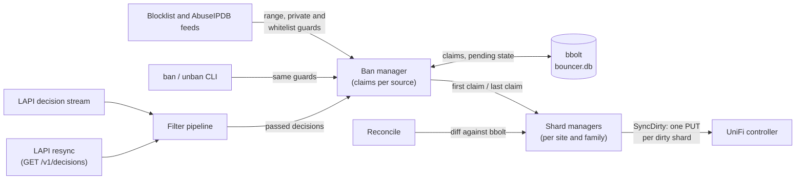
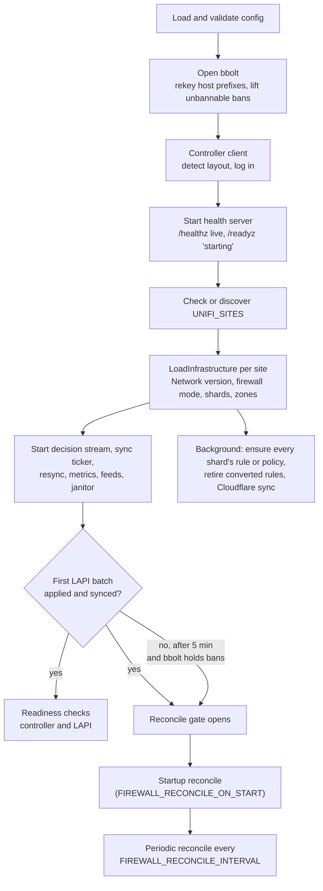
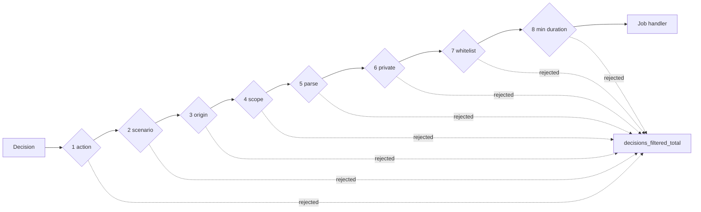
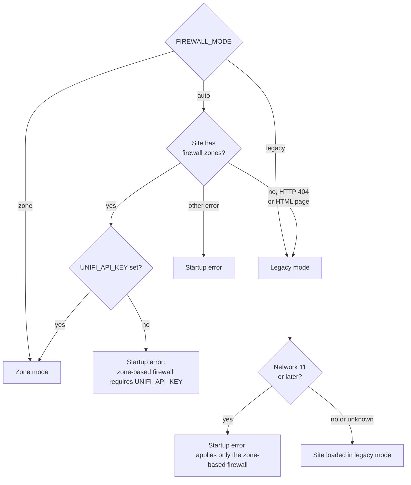
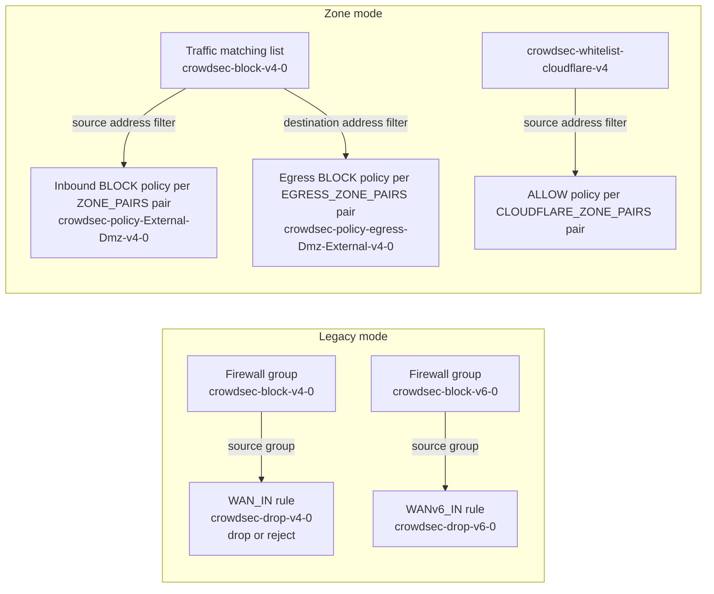
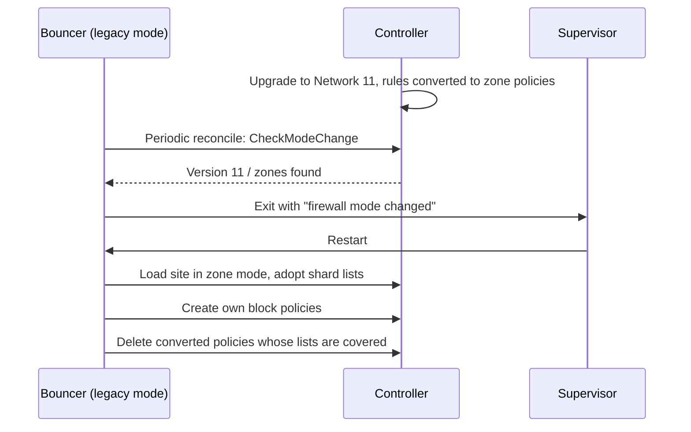
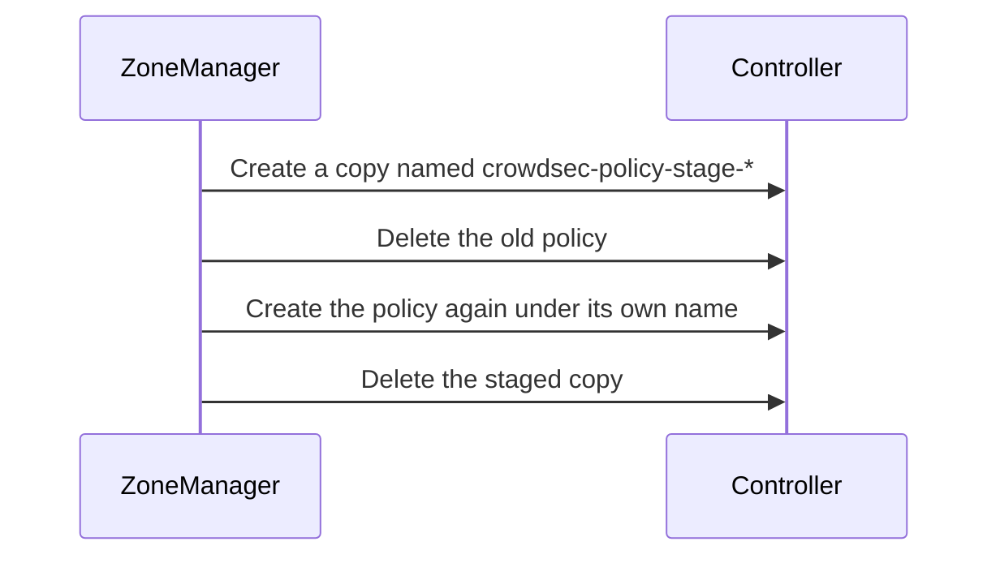
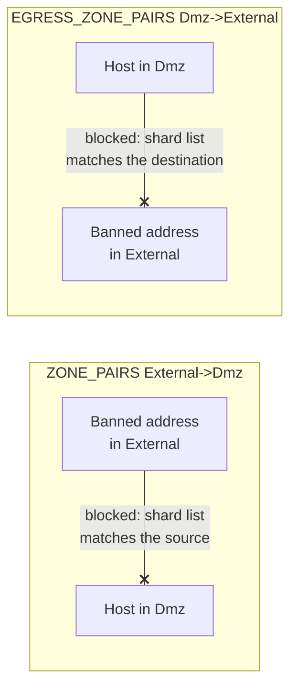
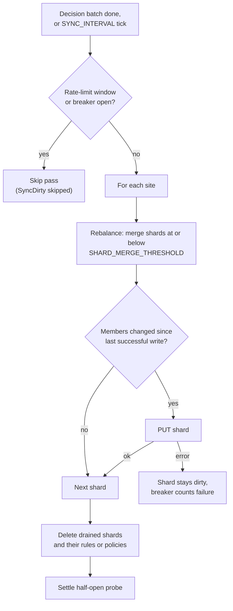
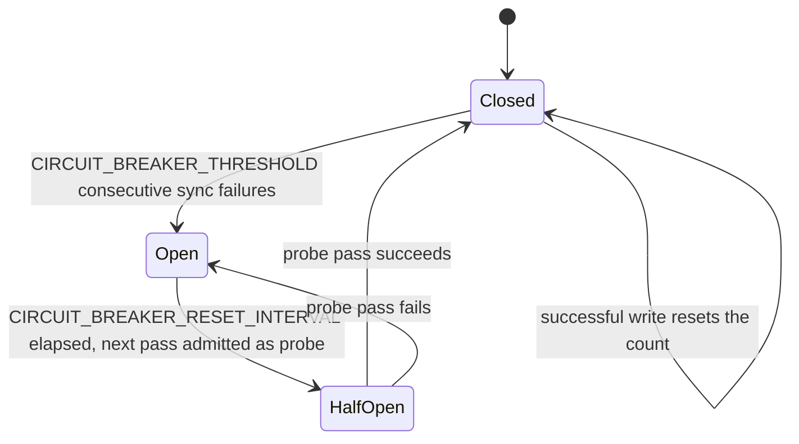

# Design & Architecture

Rationale and architectural decisions for cs-unifi-bouncer-pro.

## Table of Contents

- [Goals](#goals)
- [Language Choice](#language-choice)
- [Architecture Overview](#architecture-overview)
- [Startup Sequence](#startup-sequence)
- [Filter Pipeline](#filter-pipeline)
- [Decision Handling](#decision-handling)
- [Firewall Abstraction](#firewall-abstraction)
  - [Firewall objects](#firewall-objects)
  - [UniFi Network 11](#unifi-network-11)
  - [Zone policy constraints](#zone-policy-constraints)
  - [Egress policies](#egress-policies)
  - [Orphan cleanup](#orphan-cleanup)
- [Shards and Syncing](#shards-and-syncing)
  - [Circuit breaker and rate limits](#circuit-breaker-and-rate-limits)
  - [Write ordering and crash recovery](#write-ordering-and-crash-recovery)
- [State Management](#state-management)
- [Session Recovery](#session-recovery)
- [Template-Based Naming](#template-based-naming)
- [Observability](#observability)
- [Security Posture](#security-posture)
- [Testing Approach](#testing-approach)

---

## Goals

1. **Correctness** — bans must be applied idempotently and survive container restarts without re-banning or double-banning IPs
2. **Performance** — handle large ban waves without overwhelming the UniFi API or blocking the CrowdSec stream
3. **Compatibility** — support both legacy `WAN_IN` firewall rules (sites without firewall zones, up to UniFi Network 10.x) and zone-based policies (the only firewall from UniFi Network 11) from a single binary
4. **Operability** — provide enough observability (metrics, health endpoints, structured logs) to diagnose problems without attaching a debugger
5. **Security** — the bouncer handles credentials; it must not leak them and must run with minimum privilege

---

## Language Choice

Go was selected for three reasons:

1. **Single static binary** — no runtime dependency, no interpreter, no shared libraries. The binary is copied into a distroless container with only CA certificates beside it. The resulting image is about an 8 MB download and about 31 MB unpacked.
2. **Concurrency primitives** — goroutines and channels map directly onto the stream processor and periodic sync model. The `golang.org/x/sync/errgroup` package simplifies coordinated shutdown.
3. **TLS and HTTP** — the standard library's `net/http` and `crypto/tls` packages handle UniFi and CrowdSec LAPI connections without additional dependencies.

---

## Architecture Overview

Decisions reach the ban database from four sources, and every firewall change goes through the same ban manager, shard managers and controller client:

Every filtered decision updates its source's claim in bbolt and, when it is the first claim on an address or the last one to go, changes the in-memory shard; dirty shards are written to the controller after each decision batch.

The main packages:

| Package | Role |
|---------|------|
| `cmd/bouncer` | CLI subcommands, daemon wiring, startup sequence, reconcile gate, SIGHUP reload |
| `internal/config` | Environment loading, `_FILE` secrets, defaults and validation |
| `internal/bouncer` | LAPI stream consumer, periodic resync, job handler, janitor, health server |
| `internal/decision` | Filter pipeline, IP parsing, private-range and whitelist checks |
| `internal/banstate` | Ban manager: claims per source and their firewall transitions |
| `internal/firewall` | Mode selection, shard managers, legacy rules, zone policies, reconcile, circuit breaker |
| `internal/controller` | UniFi HTTP client: layout and version detection, login, classic, v2 and integration APIs |
| `internal/storage` | bbolt store and the dry-run store |
| `internal/blocklist`, `internal/feedhttp` | Plain-text and AbuseIPDB feed imports |
| `internal/whitelist` | Cloudflare ALLOW policies and their lists |
| `internal/webhook`, `internal/metrics`, `internal/lapimetrics` | Notifications, Prometheus metrics, CrowdSec usage metrics |

The stream processor runs in its own goroutine and handles each decision inline: no job queue, no retries at the job layer. The stream, periodic sync, resync and metrics server share an `errgroup.Group`, so one of them failing stops the others.

---

## Startup Sequence

The daemon brings components up in an order that keeps probes answering during a long first load and keeps reconcile away from a database that may not hold the bans yet:

A failed configuration, store, controller login, site check or infrastructure load stops startup with an error on stderr; a failure of the background repair, other than a shard that could not be provisioned, stops the daemon later so the supervisor restarts it.

Details of the steps:

- **Store**: bans stored as `/32` or `/128` host prefixes are rekeyed under the bare address (UniFi refuses host prefixes). Stored bans that the current `BLOCK_WHITELIST`, the private-range check or the range limit would refuse are deleted (`banstate.DropUnbannable`) with a warning, so a whitelist change takes effect on restart; reconcile then removes them from the controller.
- **Controller client**: `internal/controller/layout.go` detects the layout from `GET /`: UniFi OS consoles answer it directly, while the self-hosted Network Application redirects to `/manage`. The layout selects the login path (`/api/auth/login` or `/api/login`) and the prefix for classic and v2 API calls (`/proxy/network` or none). The integration API path is the same on both. A controller that answers `GET /` with an error status stops startup with `controller ... is not ready`.
- **Health server**: it starts before the firewall infrastructure is loaded, so `/healthz` answers while a large ban list is loaded and pulled from the LAPI, which can take several minutes.
- **LoadInfrastructure**: reads the Network version once, resolves each site's mode (below), loads the shards from bbolt and the controller, warns about objects named like this instance's own that bbolt has no record of, and in zone mode resolves the site UUID and zones. Bans can be applied as soon as it returns.
- **Repair**: `RepairInfrastructure` ensures the block policy or legacy rule of every loaded shard. It runs beside the decision stream, so new bans are applied meanwhile; a shard whose rule or policy cannot be provisioned is logged and retried by the next sync.
- **Reconcile gate**: reconcile removes controller addresses that bbolt does not hold. A new or lost database holds no bans until the LAPI resends the active decisions, so reconciling earlier would strip every enforced ban from the controller. Reconciles start after the first stream batch has been applied and synced (`startup stream batch synced to UniFi`). If no batch arrives within 5 minutes and the database already holds bans, they start from that database; an empty database keeps waiting.

---

## Filter Pipeline

Decisions from CrowdSec pass through eight stages before they reach the ban manager. Each stage that rejects a decision increments `crowdsec_unifi_decisions_filtered_total` with a `stage` and `reason` label.

A ban runs every stage in order; a deletion runs only stages 1, 4 and 5.

| Stage | Condition | Rationale |
|-------|-----------|-----------|
| `1_action` | Decision type is not in `BLOCK_DECISION_TYPES` (default `ban`) | Only bans, the types enforced as bans, and their deletions change firewall state |
| `2_scenario_exclude` | Scenario contains a `BLOCK_SCENARIO_EXCLUDE` substring | Skip scenarios inappropriate for IP banning (e.g. account compromise) |
| `3_origin` | Origin not in `CROWDSEC_ORIGINS` (when set) | Optionally restrict to selected decision origins |
| `4_scope` | Scope is not `ip` or `range` | UniFi accepts only IP addresses and CIDRs |
| `5_parse` | Required field missing (`missing_field`), IP malformed (`parse_error`), or range broader than `/8` IPv4 / `/32` IPv6 (`range_too_broad`) | Reject garbage values and oversized ranges from upstream |
| `6_private` | Address is RFC 1918, CGNAT (100.64.0.0/10), loopback, link-local or ULA | Private addresses must not be blocked at the network edge |
| `7_whitelist` | Address overlaps `BLOCK_WHITELIST` | Trusted ranges, such as the site's own WAN address |
| `8_min_duration` | Ban duration is not positive, or below `BLOCK_MIN_DURATION` | Drop expired and short test decisions |

Deletions skip stages 2, 3, 6, 7 and 8. A deletion only releases the claim its own decision made (a no-op if the ban was never applied), so narrowing `BLOCK_SCENARIO_EXCLUDE`, `CROWDSEC_ORIGINS` or `BLOCK_WHITELIST` does not strand bans applied before the change.

After stage 8 the longest `BLOCK_SCENARIO_DURATION_MAP` key contained in the scenario replaces the ban's duration. The pipeline is a single function (`decision.Filter`, `decision.FilterDeleted`) that returns a `FilterResult`; it has no goroutines or channels.

Blocklist feeds and the `ban` subcommand do not go through the pipeline, but they apply the same range, private and whitelist guards (`decision.Unbannable`).

---

## Decision Handling

Ban and unban decisions are processed synchronously, one CrowdSec decision batch at a time. Each source owns a claim on an address: a CrowdSec decision by its ID or UUID, a feed by an opaque key, a manual ban as `manual`. The ban manager (`internal/banstate`) serializes claim changes from all sources:

1. **Ban** — the claim is written to bbolt first, marked pending when it is the address's first active claim. The address is then added to its in-memory shard and the pending flag is cleared. A further claim on an already banned address only extends its ownership.
2. **Delete** — the decision's claim is removed. Only when no active claim remains is the address removed from its shard and the bbolt record deleted.
3. **Dry run** — the handler logs the intended change and persists nothing.

Re-delivered decisions update the same claim after a reconnect, while distinct decisions and feeds independently keep the ban alive. After all decisions in a batch are handled, `SyncDirty` writes the dirty shards to the controller (see [Shards and Syncing](#shards-and-syncing)).

The bans of a batch are claimed 500 at a time: one bbolt transaction records their claims, the new ones marked pending, and a second clears the pending flag of those added to their shards. Their history events are written together in a third, so a burst of decisions costs three disk syncs per 500 instead of three per decision. Deletions follow the bans of the batch one at a time, in the order the LAPI sent them.

`DECISION_RATE_LIMIT` puts a token bucket in front of the job handler, so a large ban wave is applied at a bounded rate instead of all at once. Decisions admitted within the burst are claimed together; once the bucket is empty, each decision is applied as soon as it is admitted.

---

## Firewall Abstraction

`firewall.Manager` is the interface the daemon and CLI use: `LoadInfrastructure` and `RepairInfrastructure` (together `EnsureInfrastructure`), `ApplyBan`, `ApplyUnban`, `SyncDirty`, `Reconcile`, `PrepareDrain` and `Drain`, `ZoneManager` for the SIGHUP reload and the Cloudflare whitelist, and `CheckModeChange`. Its implementation keeps one shard manager per site and address family and delegates rule and policy work to two mode-specific components:

- **`LegacyManager`** — `WAN_IN`/`WANv6_IN` rules (or the configured rulesets) that drop traffic from a shard's firewall group
- **`ZoneManager`** — zone resolution, per-pair filter lists, block policies for every pair, shard and family, and their cleanup

The mode is resolved per site when the infrastructure is loaded:

In `auto` mode, feature detection (`internal/controller/features.go`) checks each site for firewall zones and caches the result. With an API key it lists zones through the integration v1 API; with a session login, which that API rejects, it reads `/v2/api/site/<site>/firewall/zone`. A site with no zones, or a controller without the endpoint (HTTP 404 or an HTML fallback page), is treated as legacy. A session-authenticated site that has zones stops startup with an error asking for an API key, because zone policies can only be written through the integration API. Any other probe error also stops startup rather than guessing the mode, because legacy objects created on a zone-based site would never be enforced.

The resolved mode is not logged on its own. A zone-mode site logs `zone discovery complete` with its zone count, and `diagnose` reports each site's mode in its `firewall_mode[<site>]` row.

### Firewall objects

Both modes keep the banned addresses in shards of at most 10,000 entries per family. The object types differ:

In legacy mode each shard is a firewall address group with one rule; in zone mode each shard is a traffic matching list that every inbound and egress pair references through one block policy per shard and family.

A classic firewall address group and an integration traffic matching list are the same controller object, which is why the shard lists survive a site's move to the zone-based firewall and are adopted by name. Per-pair port and destination-IP filters are separate lists (`crowdsec-ports-*`, `crowdsec-dstips-*`) attached to the pair's policies.

### UniFi Network 11

Network 11 moves every site to the zone-based firewall on upgrade and stops applying legacy rules. Four pieces handle that:

1. **Version**: `Controller.ApplicationVersion` reads `applicationVersion` from `/integration/v1/info` with an API key, or `version` from the site's `stat/sysinfo` with a session. `LoadInfrastructure` reads it once and logs it (`detected UniFi Network version`), and `controller.NetworkVersion.ZoneOnly()` is true from major version 11. A version that cannot be read is logged and treated as a release that still applies legacy rules, so a controller that hides it is not refused.
2. **Refusal**: on a zone-only release, a site that resolves to legacy mode (explicitly, or `auto` with no zones) stops startup, because Network 11 answers a legacy rule write with success but neither stores nor enforces the rule. Network 11 lists its system zones (External, Internal, Gateway, Vpn, Hotspot, Dmz) and accepts zone policies even on a site with no gateway adopted, so `auto` resolves such a site to zone mode; its policies take effect once a gateway is adopted.
3. **Re-check**: the mode is resolved once, and shard managers, rules and policies are built for it. `CheckModeChange` runs before each periodic reconcile for the sites loaded in legacy mode. It reads the version again and, in `auto` mode, clears the site's feature cache and checks for zones again. A zone-only release or newly found zones return a `ModeChangeError`, and the daemon exits so its supervisor restarts it in zone mode. Rebuilding the managers in place would need every component that holds them to be restarted anyway. A failed check (the controller restarting mid-upgrade) is retried on the next tick.
4. **Converted rules**: the migration converts legacy rules into zone policies, and a converted bouncer rule is expected to keep the rule's name and block the same shard list. Zone mode does not own those policies (wrong name prefix, no `zone` cache record), and UniFi refuses to delete a list a policy references. `RepairInfrastructure` therefore deletes, after `EnsurePolicies`, every BLOCK or REJECT policy named like a legacy rule (a `legacy` cache record of the site, or the rule prefix) whose source is a managed shard list, but only when every managed list it blocks is the source of an enabled block policy the bouncer owns. Once none are left it drops the site's `legacy` cache records. Kept policies mark the site: each reconcile retries the retirement after re-ensuring the block policies, and pruning, shard draining and orphan cleanup then delete the converted policies of a list before deleting the list; `drain` always does.

A bouncer that runs through the controller upgrade exits once and comes back in zone mode; the converted policies stay in place until its own block policies cover the same lists, so the bans are enforced throughout.

Network 11 also adds `reportFlowEnabled` to firewall policies (whether matches appear in Insights Flows) and sets it to true when a write leaves it out. The bouncer does not manage it: new policies leave it out, and every update, staged replacement and recreation sends the value the policy already has, so a choice made in the UniFi UI survives repairs. Controllers before 11 neither report nor receive it.

### Zone policy constraints

The UniFi zone policy API has these filter constraints:

1. **Nesting**: `portFilter` must be nested inside `trafficFilter` on both source and destination — the POST endpoint rejects it as an unknown property if placed at the top level of `$.source` or `$.destination`.
2. **`trafficFilter.type`**: When the only filter required is port-based (no IP/network filter), `trafficFilter.type` must be `"PORT"`. Using `"NETWORK"` requires a non-null `networkFilter`; using `"IP_ADDRESS"` requires a non-null `ipAddressFilter`. `"PORT"` is the dedicated port-only type and accepts only `portFilter`.
3. **PUT exclusion**: The PUT endpoint (`/v1/firewall/policies/{id}`) rejects `portFilter` even when correctly nested. The wire structs used for PUT (`apiV1PolicyUpdateSrc` / `apiV1PolicyUpdateDst`) omit the source port filter and the whole destination `trafficFilter`, and the server replaces the policy, so a PUT drops the port and destination IP filters. A filtered policy is therefore never updated in place. A block policy is replaced through a staged copy, so the shard is never uncovered (sequence below). A Cloudflare ALLOW policy is deleted and recreated.
4. **Address family**: a destination IP list must match the policy's IP version; UniFi answers HTTP 500 to an IPv6 policy with an IPv4 destination list. A pair whose destination IPs are all one family gets policies for that family only.
5. **Order**: policies created through the integration API are evaluated in creation order and cannot be moved with the ordering endpoint (`non-user-defined-policy-ordering-forbidden`). After each Cloudflare sync, a managed block policy that precedes an ALLOW of the same pair and family is replaced the same way as in item 3 (`ZoneManager.RecreatePolicies`), which puts it behind the ALLOW without uncovering the shard. Block policies the bouncer does not own are reported, never touched.

At every step at least one block policy covers the shard; a staged copy left behind by an interrupted replacement is deleted by the next pass or by `drain`.

### Egress policies

`EGRESS_ZONE_PAIRS` pairs are appended to the zone manager's pair list with `ZonePair.Egress` set, so zone resolution, port lists, the orphan sweep, shard pruning, SIGHUP reload and drain handle them like inbound pairs. Their block policy differs in three ways:

- **Address filter**: the shard list is the destination `ipAddressFilter` and the source carries no address filter. Code that needs the list a block policy matches reads it through `policyListID`, which returns the source list or, for an egress policy, the destination list. A policy with a destination filter is never updated with a PUT (item 3 above), so every change to an egress policy replaces it through a staged copy.
- **Names**: `Namer.EgressPolicyName` puts `egress-` after the policy template's literal prefix, and the pair's port lists get the same marker, so an inbound and an egress pair over the same zones never share a policy or a list. The names keep the prefix, so ownership checks treat them like inbound policies.
- **Connection states**: `EGRESS_CONNECTION_STATES`, `NEW` by default, so replies to allowed inbound connections pass.

An inbound pair stops banned addresses from opening connections into the destination zone; an egress pair stops hosts in its source zone from opening connections to banned addresses.

Order works against egress: an ALLOW for the same zones evaluated earlier lets its traffic through, and recreating the block only moves it further back. After `EnsurePolicies`, such ALLOW policies are logged as a warning, once per change, and the `crowdsec_unifi_zone_block_policies` gauge records the inbound and egress policy counts per site. On a site loaded in legacy mode (`FIREWALL_MODE=auto` without zones), egress pairs have no effect and a warning says so.

### Orphan cleanup

When a zone pair is removed from `ZONE_PAIRS`, `EGRESS_ZONE_PAIRS` or `CLOUDFLARE_ZONE_PAIRS`, previously managed firewall objects are cleaned up:

- **Block policies**: at `EnsurePolicies` time, two complementary sweeps run. Pass 1 (bbolt-based) deletes a tracked policy no longer expected by the current config when its API ID, name, and `BLOCK` action match the cache record. Pass 2 (API-based) deletes an orphan without a cache record only when its name has the configured policy prefix, its description matches the managed description, and its action is `BLOCK`.
- **Converted legacy rules**: on a zone-mode site, zone policies converted from the bouncer's legacy rules are deleted once its own block policies cover their lists (see [UniFi Network 11](#unifi-network-11)).
- **Legacy rules**: at `EnsureRules` time, the API-level orphan sweep deletes any rule whose description, action, ruleset and non-empty source groups match what the bouncer creates, and whose name has the rule prefix or a cache record, but is not in the currently expected set.
- **Block filter lists**: at `Bootstrap` time, lists named `crowdsec-ports-src-*`, `crowdsec-ports-dst-*`, `crowdsec-dstips-v4-*` and `crowdsec-dstips-v6-*` that no current zone pair needs are deleted.
- **Cloudflare ALLOW policies**: at each Cloudflare sync, policies with the `crowdsec-whitelist-cloudflare-` prefix not in the current `CLOUDFLARE_ZONE_PAIRS` set are deleted. Policies with the managed description or an empty description (from releases that set none) are considered bouncer-owned. UniFi's auto-created `(Return)` mirror policies are cleaned up with their forward policy. When `CLOUDFLARE_WHITELIST_ENABLED=false` and an API key is set, every `crowdsec-whitelist-cloudflare-*` policy and list is removed at startup.
- **Cloudflare filter lists**: at each Cloudflare sync, lists named `crowdsec-whitelist-cloudflare-srcports-*`, `crowdsec-whitelist-cloudflare-dstports-*` and `crowdsec-whitelist-cloudflare-dstips-*` that no current Cloudflare zone pair needs are deleted.

Orphan cleanup checks managed names and descriptions or matching cache records before deleting firewall objects. Keep user-created objects outside the configured managed name prefixes.

---

## Shards and Syncing

Each (site, family) combination has its own `ShardManager`, which keeps an in-memory copy of every shard's members. `ApplyBan` and `ApplyUnban` change that copy and mark the shard dirty; they do not write the members to the controller. Updating a firewall group or list takes a `PUT` with the full member list, so one `PUT` per ban would be wasteful during ban waves. Instead, after every decision batch `SyncDirty` writes each dirty shard once:

A shard whose write fails stays dirty and is retried at the next `SYNC_INTERVAL` tick; a shard whose members match the last successful write is skipped without a request.

- **Capacity**: a shard holds up to `SHARD_LIMIT`, or the smaller `SHARD_LIMIT_V4` or `SHARD_LIMIT_V6` for its family, at most 10,000. Addresses are bin-packed: each shard fills before a new one is created. A new shard takes the number after the highest one in use and gets its rule or policies when its list first exists on the controller.
- **Rebalance**: a shard at or below `SHARD_MERGE_THRESHOLD` addresses (default half the capacity) is drained into others when they have room, and its rule or policies and list are deleted once its members are written elsewhere. Empty trailing shards, shard 0 included, are pruned the same way at the next reconcile. Until then an emptied shard holds a documentation address (`192.0.2.1` or `2001:db8::1`), because the controller refuses an empty list; a shard list found holding only that address at startup is deleted together with its rule or policies. The next ban of the family creates a shard again.
- **Pacing**: `FIREWALL_API_SHARD_DELAY` spaces out structural writes (rule creates, a new shard's policies, group deletes); membership `PUT`s are not delayed.
- **Reconcile**: compares each shard manager with the controller and with bbolt, adds missing addresses, removes extra ones (each change re-checked against bbolt just before it is made), and rewrites groups edited outside the bouncer.

### Circuit breaker and rate limits

A controller that answers `429 Too Many Requests` opens a rate-limit window of its `Retry-After`; `SyncDirty` skips every pass until it ends. Persistent failures open a three-state circuit breaker:

While the breaker is open `crowdsec_unifi_circuit_breaker_open` is `1` and syncs are suspended; the next admitted pass after the reset interval is the probe that closes or reopens it.

A probe pass without errors is confirmed with a controller ping before the breaker closes. The `circuit_breaker_open` and `circuit_breaker_close` webhook events fire on the transitions. Bans received while the breaker is open are recorded and written once it closes.

### Write ordering and crash recovery

A ban is recorded in bbolt, marked pending, before it touches a shard, and the controller write happens later in `SyncDirty`. An unban removes the address from its shard before the bbolt record is deleted. A crash at any point leaves bbolt holding at least every ban that has not been lifted, and the startup reconcile writes the controller to match: missing addresses are added, addresses bbolt no longer holds are removed. Bans still marked pending (their shard update failed) are retried by reconcile and by the next claim of the same address.

---

## State Management

Persistent state is stored in a single [bbolt](https://github.com/etcd-io/bbolt) database (`bouncer.db` in `DATA_DIR`) with four buckets:

| Bucket | Key | Value |
|--------|-----|-------|
| `bans` | IP string | msgpack-encoded `BanEntry` with expiry, source claims, and pending state |
| `groups` | site and group name | msgpack-encoded `GroupRecord` with UniFi ID, shard index, family, and members |
| `policies` | site and policy name | msgpack-encoded `PolicyRecord` with UniFi ID and firewall mode |
| `events` | uint64 big-endian sequence | JSON-encoded `EventEntry` {Action, Origin, Scenario, IP, RecordedAt} |

The `events` bucket is a ring buffer. Keys are auto-incrementing uint64 values encoded as 8-byte big-endian, which guarantees chronological cursor iteration. When the entry count exceeds `HISTORY_MAX_EVENTS`, the oldest entries (lowest keys) are pruned in the same write transaction. The key count is determined by cursor iteration rather than `Stats().KeyN` (which reflects stats at transaction start, not after mid-transaction mutations).

bbolt provides ACID transactions with a single writer at a time, and the daemon holds an exclusive lock on the file. The offline commands (`reconcile`, `drain`, `ban`, `unban`) open it themselves and need the daemon stopped; `status` reads a snapshot from the running daemon instead (see [Health endpoints](#health-endpoints)). `DRY_RUN` uses a store that reads `bouncer.db` if it exists and keeps every write in memory.

### Startup and periodic reconcile

The startup reconcile runs once the [reconcile gate](#startup-sequence) opens and `FIREWALL_RECONCILE_ON_START=true`. It and every periodic reconcile:

1. Read all active bans from bbolt
2. Read every managed group or list from the controller
3. Compute the difference per site and family
4. Add missing addresses and remove unexpected ones, then write the changed shards

This corrects drift caused by manual edits, controller restarts, or bouncer downtime. The result is logged and recorded in the `crowdsec_unifi_reconcile_duration_seconds` histogram (`trigger` = `startup`, `periodic` or `manual`) and the `crowdsec_unifi_reconcile_delta` gauge.

The list of traffic matching lists carries every member of every shard, several megabytes of JSON with 100k bans. A reconcile, a startup load and repair, and a Cloudflare whitelist sync therefore each run as one listing pass (`controller.BeginPass`): the first step that needs a site's lists, policies, groups or rules fetches them, and the later steps read that copy. Every write the bouncer makes, during the pass or concurrently, is applied to the copy, so later steps see the objects earlier ones created, changed or deleted. Edits made elsewhere show in the next pass. Steps that must see the controller as it is now list it afresh: confirming a 404 before an object is treated as deleted, finding the object behind a refused create, checking the order of Cloudflare allows and blocks, and the whitelist's policy sweep.

### LAPI resync

Every `CROWDSEC_RESYNC_INTERVAL` (default 1 hour) the bouncer re-reads all active decisions with `GET /v1/decisions`, which does not move the stream cursor, and applies any that pass the filters but have no claim in bbolt. This recovers decisions the stream skipped: the LAPI stores `created_at` in whole seconds and compares it with a sub-second poll time, so a decision created in the same second as a poll is otherwise only delivered after a restart. Missed deletions are not recovered this way; those bans end at their expiry. The list is decoded one decision at a time as it streams in, and a response over 64 MiB, with more than 500,000 decisions, or with data after the list fails that resync without applying any of it.

### Janitor

A background goroutine runs every `JANITOR_INTERVAL` (default 1 h):

- Lifts ban claims whose expiry has passed; the IP is unbanned when no claim remains, and the unban reaches UniFi at the next sync
- Writes an `action=expire` event to the audit trail ring buffer for each lifted ban
- Updates the `crowdsec_unifi_db_size_bytes` gauge

Claim expiries are set when a decision is received: a decision with no duration, an unparseable one, or one longer than `BAN_TTL` expires at `now + BAN_TTL`. A `BLOCK_SCENARIO_DURATION_MAP` override is not capped. If CrowdSec still holds the decision, a restart or the periodic resync applies it again for another `BAN_TTL`.

### Ban history

Every successful ban, unban, and janitor expiry is appended to the `events` bucket as an `EventEntry`. The `Store` interface exposes four methods for it:

- `RecordEvent(e EventEntry) error` — append an event (ring-buffer eviction on overflow)
- `RecordEvents(events []EventEntry) error` — append several events in order in one transaction
- `ListEvents(limit int) ([]EventEntry, error)` — newest-first, bounded by `limit`
- `ListEventsForIP(ip string, limit int) ([]EventEntry, error)` — newest-first, filtered by IP

The `status history` and `status ip` subcommands read them.

### External blocklists

`internal/blocklist.Manager` fetches plain-text IP/CIDR URLs on startup and on a ticker. Generic `BLOCKLIST_URLS` and the optional AbuseIPDB importer have separate claim namespaces even when they use the same URL. Each source key is a stable hash of the URL, prefixed by importer kind; the URL path and query are absent from stored claims and logs. Startup migration rekeys legacy URL-based claims while retaining their expiry. Addresses are claimed in chunks of 500, so CrowdSec decisions interleave with a large import.

The AbuseIPDB importer selects a report window and can include or exclude entries by the two-letter country tag in each line's comment. A complete refresh applies valid entries and immediately releases that importer's claims for entries no longer selected. A fetch that looks damaged never prunes: a response containing invalid lines, a feed that lists fewer than half the entries of its last full fetch, and a country filter that matches none of the entries all keep the existing claims.

Refreshes set claim expiry to `now + 2×interval`. A failed or partial fetch can extend existing claims for up to `BAN_TTL` after the last complete fetch; after that, claims absent from valid entries are allowed to expire. The firewall ban remains while any other feed or CrowdSec decision still claims the IP.

### Webhook notifications

`internal/webhook.Notifier` posts a small JSON payload to `WEBHOOK_URL` when a named event fires. The notifier is a no-op when the URL is empty, in dry-run mode, or when the event is not in `WEBHOOK_EVENTS`. Events are queued (up to 64) and delivered in the background; HTTP errors are logged at `warn` level and never propagate to the caller.

Events come from circuit breaker state changes (`OnCircuitBreakerOpen` / `OnCircuitBreakerClose` callbacks on `ManagerConfig`), shard create failures and refused ban entries (the `ShardEvents` callbacks on `ManagerConfig`), reconcile drift (a periodic reconcile with `added + removed >= 100`), the exit on a firewall mode change, and failed Cloudflare whitelist syncs. The payload is `{"event", "timestamp", "detail"}`; `detail` is omitted for the circuit breaker events. The callbacks are plain functions, so the `firewall` package has no import dependency on `webhook`.

Shard create failures, refused entries and Cloudflare sync failures recur on every retry while the cause persists. `Notifier.FireLimited` sends each at most once an hour per subject (a shard, an entry, the sync) and counts the ones it held back in the next payload's `suppressed` field. It remembers at most 1024 subjects; past that, an event about a new subject is dropped until older subjects expire. When the daemon exits on its own, as on a firewall mode change, it stops the notifier and waits for it to deliver the queued events before exiting.

---

## Session Recovery

With `UNIFI_USERNAME`/`UNIFI_PASSWORD` the bouncer holds a session cookie (and, on UniFi OS, a CSRF token), and the controller answers `401 Unauthorized` once the session expires. The session manager handles this:

1. A request that receives a 401 calls `EnsureAuth`
2. Logins are serialized, so many requests failing at once cause one login; requests that arrive while it runs wait for it
3. A login completed within `SESSION_REAUTH_MIN_GAP` is reused instead of logging in again
4. After a successful login, the failed request is retried once

Failed logins back off: a refused login (HTTP 400, 401 or 403) waits up to 30 minutes before the next attempt, and consecutive 429s wait 1, 2, 4, 8 and then 16 minutes, because a few failed attempts lock UniFi OS logins for well over ten minutes. With `UNIFI_API_KEY` there is no session: the key is sent with every request, and a 401 means the key itself was revoked.

---

## Template-Based Naming

All managed UniFi objects are named using Go `text/template` patterns configured via environment variables:

- `GROUP_NAME_TEMPLATE` — address groups and traffic matching lists (the shards)
- `RULE_NAME_TEMPLATE` — legacy rules
- `POLICY_NAME_TEMPLATE` — zone block policies

Template variables include `.Family` (v4/v6), `.Index` (shard), `.Site`, `.SrcZone`, and `.DstZone`. Each template is rendered at startup for two shard indexes; startup fails if rendering errors, the name is empty, or both indexes give the same name (the template lacks `{{.Index}}`). The literal text before the first `{{` is the template's prefix, which ownership checks and orphan sweeps match.

This design allows:

- **Multi-instance deployments** — two bouncers (e.g. production and staging) use distinct name prefixes and coexist on the same controller
- **Renaming** — naming schemes can change between deployments without modifying code

The per-pair filter lists, staged policies and Cloudflare whitelist objects have fixed names (see [Object Naming Templates](CONFIGURATION.md#object-naming-templates)).

---

## Observability

### Prometheus metrics

28 metrics under the `crowdsec_unifi_` namespace are served at `/metrics` on `METRICS_ADDR` (default `:9090`) while `METRICS_ENABLED=true`:

| Metric | Type | Labels | Description |
|--------|------|--------|-------------|
| `crowdsec_unifi_decisions_processed_total` | Counter | `action` (`ban`, `unban`), `source` (`stream`, `resync`) | Decisions that passed the filter pipeline |
| `crowdsec_unifi_decisions_filtered_total` | Counter | `stage`, `reason` | Decisions rejected at each filter stage |
| `crowdsec_unifi_decisions_in_flight` | Gauge | | Decisions currently being processed by the job handler |
| `crowdsec_unifi_decision_latency_seconds` | Histogram | | Time from receiving a ban decision to recording it in the ban database and in-memory shard. Measured before the controller write, so it does not include UniFi API time; use `shard_sync_duration_seconds` and `unsynced_ips` for that. Buckets: 0.1, 0.5, 1.0, 2.5, 5.0, 10.0, 30.0 s |
| `crowdsec_unifi_active_bans` | Gauge | `family`, `site` | Bans the bouncer tracks, including any not yet on the controller |
| `crowdsec_unifi_unsynced_ips` | Gauge | `family`, `site` | Bans held in shards that are not enforced yet: the shard object or its block policy/rule is missing on the controller, or the controller refused the entry itself. Alert when above 0 for more than a few minutes |
| `crowdsec_unifi_api_calls_total` | Counter | `endpoint`, `status`, `site` | UniFi API calls. `site` is empty for calls that belong to no site, such as the ping and the site list |
| `crowdsec_unifi_api_duration_seconds` | Histogram | `endpoint`, `site` | UniFi API call latency |
| `crowdsec_unifi_auth_errors_total` | Counter | | Failed username/password logins to the controller |
| `crowdsec_unifi_reauth_total` | Counter | | Successful username/password logins, including the initial login |
| `crowdsec_unifi_reconcile_duration_seconds` | Histogram | `trigger` (`startup`, `periodic`, `manual`) | Full reconcile duration |
| `crowdsec_unifi_reconcile_delta` | Gauge | `direction` (`added`, `removed`), `site` | IPs added or removed by the last reconcile |
| `crowdsec_unifi_firewall_group_size` | Gauge | `family`, `shard`, `site` | Members per shard |
| `crowdsec_unifi_shard_occupancy_ratio` | Gauge | `family`, `shard`, `site` | Fraction of shard capacity in use (`ip_count / shard_limit`). `1.0` = shard full; alert at `> 0.9` |
| `crowdsec_unifi_shard_ip_count` | Gauge | `family`, `shard`, `site` | IPs written to each shard at its last successful sync |
| `crowdsec_unifi_shard_sync_total` | Counter | `family`, `shard`, `site`, `result` | Shard sync attempts |
| `crowdsec_unifi_shard_sync_duration_seconds` | Histogram | `family`, `shard`, `site` | Shard sync duration |
| `crowdsec_unifi_shard_create_failures_total` | Counter | `family`, `site` | Failed attempts to create a shard object. Creates back off exponentially (30s up to 30m); the log line carries the controller's reason |
| `crowdsec_unifi_shards_rebalanced_total` | Counter | `family`, `site` | Shards drained by the rebalance pass |
| `crowdsec_unifi_dirty_shards` | Gauge | | Shards pending sync at the last `SyncDirty` call |
| `crowdsec_unifi_last_sync_timestamp_seconds` | Gauge | | Unix timestamp of the last `SyncDirty` pass that wrote every dirty shard. Alert when it is older than a few minutes |
| `crowdsec_unifi_circuit_breaker_open` | Gauge | | `1` when the sync circuit breaker is open, `0` otherwise. Alert when it stays `1` for more than a minute |
| `crowdsec_unifi_zone_block_policies` | Gauge | `direction` (`inbound`, `egress`), `site` | Zone block policies the bouncer keeps on the controller |
| `crowdsec_unifi_db_size_bytes` | Gauge | | bbolt database file size, updated by the janitor |
| `crowdsec_unifi_cloudflare_whitelist_sync_errors_total` | Counter | | Failed Cloudflare whitelist syncs |
| `crowdsec_unifi_feed_entries` | Gauge | `source` | Entries the feed's last applied fetch listed, after the country filter and the range, private address and whitelist guards |
| `crowdsec_unifi_feed_last_success_timestamp_seconds` | Gauge | `source` | Unix timestamp of the feed's last fetch applied in full. A fetch applied without pruning (invalid lines, or a sharp shrink) does not move it. Alert when it is older than a few refresh intervals |
| `crowdsec_unifi_feed_fetch_errors_total` | Counter | `source` | Feed fetches that failed (unreachable, HTTP error, oversized, no valid entries, no entry passing the country filter), so the bans from the last good fetch were kept. Starts at 0 for every configured feed |

The `source` label of the feed metrics is the feed's claim source, `blocklist:sha256:<hash of the URL>` for a `BLOCKLIST_URLS` entry and `abuseipdb:sha256:<hash>` for the AbuseIPDB feed, never the URL, which may carry an access token. The `blocklist: feed configured` line logged at startup pairs each source with its host.

The `shard` label is the group name (e.g. `crowdsec-block-v4-0`) on `firewall_group_size` and `shard_occupancy_ratio`, and the numeric shard index on `shard_ip_count`, `shard_sync_total` and `shard_sync_duration_seconds`.

### CrowdSec usage metrics

The bouncer pushes decision telemetry to the CrowdSec LAPI `/v1/usage-metrics` endpoint every `LAPI_METRICS_PUSH_INTERVAL` (default 30 minutes, at least 10 minutes; `0` disables it). Each push reports a delta window, and the counters reset after every push:

- **blocked** — new ban decisions applied per `origin` × `remediation_type` since the last push
- **processed** — total decisions handled (bans applied + deletions) since the last push

This is distinct from the Prometheus metrics, which are cumulative for process dashboards. On graceful shutdown a final push is made, within `SHUTDOWN_GRACE_PERIOD`, so the last window is not lost. Dry-run mode pushes nothing.

### Health endpoints

These HTTP endpoints run on `HEALTH_ADDR` (default `:8081`):

- `GET /healthz` — liveness probe; returns 200 while the process is running
- `GET /readyz` — readiness probe; returns 503 `starting` until the first CrowdSec decision batch has been processed, then pings the UniFi controller (and the LAPI when `HEALTH_CHECK_LAPI=true`) and returns 200 only if they answer. The result, pass or fail, is cached for 5 seconds and concurrent requests share one check, so polling `/readyz` cannot multiply load on the controller or its login rate limit
- `GET /status/db` — a consistent copy of the ban database for the `status` command, which cannot open the file while the daemon holds its lock. It answers only requests from the same host that carry the token the daemon writes to `status.token` in `DATA_DIR`, and serves one copy at a time.
- `GET /status/sync` — the firewall sync state as JSON, the same values the `dirty_shards`, `unsynced_ips`, `circuit_breaker_open` and `last_sync_timestamp_seconds` metrics hold: `startup_synced`, `dirty_shards`, `unsynced_ips` with `unsynced_by_site` (site, family, count), `circuit_breaker_open`, `last_sync` (RFC 3339, or `null` before the first complete sync) and `last_sync_age_seconds`. `status sync` prints it.
- `POST /control/ban`, `POST /control/unban`, `POST /control/reconcile` — the `ban`, `unban` and `reconcile` commands while the daemon runs. Ban and unban take a JSON body, `{"ip": "203.0.113.42", "duration": "1h"}` (`duration` is optional; empty or `0` means `BAN_TTL`, longer values are capped at it) and `{"ip": "203.0.113.42"}`; reconcile takes none. A ban passes the guards CrowdSec decisions do (private, loopback and link-local ranges, `BLOCK_WHITELIST`, ranges broader than /8 or /32) and is a `manual` claim in the ban-state manager, like any other source; bans and unbans are recorded in the history with origin `manual`, and are written to UniFi at once. The answer is JSON: the address, the number of sites, the expiry or whether a ban was lifted, and `sync_error` when the change is recorded but UniFi could not be updated yet (the next sync retries it). A reconcile answers `added`, `removed`, `elapsed_seconds` and `error` for a partial run; it is refused with 503 until the first CrowdSec batch has been applied, as the periodic reconcile is, and with 409 while another requested reconcile runs.

`/status/sync` and the control endpoints are guarded exactly like `/status/db`: same host and the `X-Status-Token` header from `status.token`, or 403. A request body is at most 4 KiB of `application/json` with no unknown fields; anything else is refused with 400 or 415. The endpoints answer 503 until the firewall infrastructure has loaded, and are not served in dry-run mode.

The Docker `HEALTHCHECK` (through the `healthcheck` subcommand) and the Kubernetes liveness and startup probes use `/healthz`; the Kubernetes readiness probe uses `/readyz`.

### Structured logging

All log output is written to stderr through a `RedactWriter` that applies regexp substitutions first. Passwords, API keys, and Bearer tokens are replaced with `[REDACTED]`. The log format (`json` or `text`) and level are configurable. Messages from the go-cs-bouncer stream client, which logs through logrus, are forwarded with `"component":"crowdsec-client"`.

---

## Security Posture

| Layer | Mechanism |
|-------|-----------|
| Container | Distroless base, nonroot UID 65532, read-only filesystem |
| Capabilities | `cap_drop: ALL` |
| Syscalls | Seccomp allowlist (`security/seccomp-unifi.json`) |
| Credentials | Env vars only; `_FILE` variants for secrets; never written to disk |
| Log output | `RedactWriter` masks all sensitive values |
| TLS | Minimum TLS 1.2 on controller and LAPI connections |
| Image signing | Cosign keyless OIDC; CycloneDX SBOM on every release |
| CVE scanning | Trivy blocks release on HIGH/CRITICAL fixable CVEs |

See [SECURITY.md](../SECURITY.md) and [COMPLIANCE.md](../COMPLIANCE.md) for details.

---

## Testing Approach

Tests run without external services: the UniFi controller is replaced by `httptest` servers and an in-process fake (`internal/testutil`), and storage tests use real bbolt databases in `t.TempDir()`. Most packages use table-driven tests. Coverage includes:

- **`internal/config`**: required fields, defaults, `_FILE` injection, name templates, zone pair parsing (ports, destination IPs, egress pairs), connection states, feed and Cloudflare settings
- **`internal/decision`**: every filter stage, IP parsing and sanitisation, private-range and whitelist checks, per-scenario duration overrides, and fuzz tests for the parser
- **`internal/banstate`**: claims per source, release and expiry, host-prefix rekeying, dropping unbannable bans
- **`internal/firewall`**: shard bin-packing, rebalance and pruning, sync and the circuit breaker, reconcile races, legacy rules, zone policies (port and destination filters, staged replacement, egress, converted legacy rules, Network 11 mode checks), drain and orphan sweeps
- **`internal/controller`**: layout and version detection, login backoff and rate limits, 401 re-authentication, wire formats of lists and policies
- **`internal/bouncer`**: stream consumption, resync limits, the job handler, janitor, health endpoints and database snapshots
- **`internal/blocklist`**, **`internal/whitelist`**, **`internal/webhook`**, **`internal/lapimetrics`**, **`internal/storage`**, **`internal/logger`**: feed parsing and outage handling, Cloudflare list validation and policy order, webhook delivery, usage-metrics payloads, the event ring buffer, and redaction patterns

The race detector (`go test -race ./...`) runs in CI for all packages.
